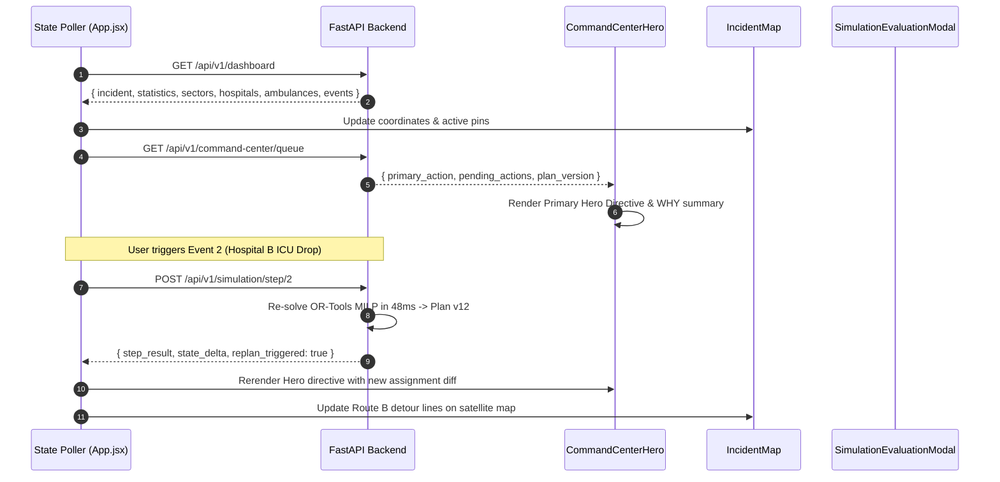

# 04_INFORMATION_ARCHITECTURE.md
## LIFELINK: Information Architecture & Component Hierarchy

---

### 1. Global Navigation & View Routing

LIFELINK operates as a high-performance single-page application (SPA) centered on a live command console with deep-dive modal drawers:

```
                                GLOBAL HEADER
  [LIFELINK ICS]   • LEVEL 1 MCI ACTIVE   [01:35 UTC]   [DASHBOARD | GIS MAP | TRIAGE | RESOURCES]
                                      │
  ┌───────────────────────────────────┼───────────────────────────────────┐
  ↓                                   ↓                                   ↓
[Command Center Hero]       [Continuous Replanning Banner]      [Simulation Engine Controls]
(Dominant Centerpiece)         (Plan v11 → v16 Diffs)              (5-Event Disruption Suite)
                                      │
  ┌───────────────────────────────────┴───────────────────────────────────┐
  ↓                                                                       ↓
4-COLUMN OPERATIONAL CONSOLE                                  DEEP-DIVE SUBSYSTEMS EXPLORER
├─ Col 1: HazMat & Radio Telemetry                            ├─ Triage Acuity (Phase 4)
├─ Col 2: Tactical GIS Satellite Map                          ├─ VRPTW Ambulance Routing (Phase 6)
├─ Col 3: Casualty Queue & START Triage                       ├─ OR-Tools Optimization (Phase 7)
└─ Col 4: Regional Hospitals & Fleet                          └─ Multi-Agent AI Perception (Phase 8)
                                      │
  ┌───────────────────────────────────┴───────────────────────────────────┐
  ↓                                   ↓                                   ↓
[WHY Explainability Modal]    [Hospital Match Modal]     [Simulation Evaluation Modal]
```

---

### 2. Detailed Component Hierarchy

```
frontend/src/
├── App.jsx                                # Master State Orchestrator & Polling Bus
│   ├── components/Header.jsx              # Defense Status, Doctrine Banner, Clocks
│   │   └── Regulatory Safety Notice       # Non-clinical decision-support warning
│   │
│   ├── components/SimulationEngineBar.jsx # 5 Killer Demo Simulation Ingestion Controls
│   │   ├── Step 1: Evidence (+17 victims, +5 critical)
│   │   ├── Step 2: Hospital B ICU Capacity Shock (2 -> 1)
│   │   ├── Step 3: Route A Severance (11 min -> 27 min detour)
│   │   ├── Step 4: Hospital B O- Blood Shortage (18 -> 3 units)
│   │   └── Step 5: Hospital C Trauma Surgical Team Mobilization
│   │
│   ├── components/CommandCenterHero.jsx   # DOMINANT CENTERPIECE: Primary Directive
│   │   ├── Top Operational Ribbon        # Active Plan v12, Time to Care, Algorithm Tag
│   │   ├── Hero Action Directive Card     # Victim ID, Assigned Ambulance, Destination, Route
│   │   ├── Multi-Factor WHY Scorecard     # ICU (35%), Trauma (25%), Blood (15%), ETA (25%)
│   │   ├── Action Button Cluster          # "EXECUTE DIRECTIVE" & "EXECUTE ALL PENDING"
│   │   └── Priority Queue Preview         # Next queued critical allocations
│   │
│   ├── components/ContinuousReplanningBanner.jsx # Versioned Replan State Machine
│   │   ├── Plan Version Badge             # PLAN v12 (Trigger: Hospital B ICU 2 -> 1)
│   │   ├── Changed Assignment Diffs       # V129: Hospital B ──► Hospital C
│   │   └── Affected Resources Strip       # St. Jude ICU (-1), Harborview ICU (Surge Ready)
│   │
│   ├── [4-COLUMN OPERATIONAL CONSOLE]
│   │   ├── Col 1: components/TacticalTelemetryPanel.jsx # Plume sensors & radio logs
│   │   ├── Col 2: components/IncidentMap.jsx            # Esri Satellite GIS & routes
│   │   ├── Col 3: components/VictimZonesPanel.jsx       # Casualty Sectors & START queue
│   │   └── Col 4: Right Rail Stack
│   │       ├── components/HospitalsPanel.jsx            # ICU, OR, blood inventories
│   │       ├── components/AmbulancesPanel.jsx           # Fleet readiness & GPS status
│   │       └── components/TimelinePanel.jsx             # Chronological audit log
│   │
│   ├── [DEEP-DIVE SUBSYSTEMS EXPLORER TABS]
│   │   ├── components/PriorityQueuePanel.jsx            # Detailed START scoring breakdown
│   │   ├── components/AmbulanceRoutingPanel.jsx         # Graph traversal & detour penalties
│   │   ├── components/ResourceOptimizationPanel.jsx     # MILP solver equation breakdown
│   │   └── components/AIAgentsPanel.jsx                 # 7 Gemini perception agents
│   │
│   └── [COMMAND & AUDIT MODALS]
│       ├── components/CommandCenterWhyModal.jsx         # Full explainability breakdown
│       ├── components/HospitalMatchModal.jsx            # Specialty capability matrix
│       └── components/SimulationEvaluationModal.jsx     # Quantitative benchmark comparison
```

---

### 3. Data Flow & State Propagation



---

### 4. Screen-by-Screen Functional Specifications

| View / Modal | Key User Actions | Data Sources | Critical Error States |
| :--- | :--- | :--- | :--- |
| **Command Center Hero** | Execute 1-click action; Execute all; Open WHY modal | `/api/v1/command-center/queue` | Displays `NO FEASIBLE ASSIGNMENT` on total resource exhaustion |
| **Tactical Satellite Map** | Toggle satellite/street; Filter pins; Inspect popups | Leaflet GeoJSON + `/api/v1/hospitals`, `/roads` | Offline fallback basemap tile caching |
| **Casualty Acuity Queue** | Search patient ID; Filter START tags; View ETA | `/api/v1/victims` | Empty queue state when all critical casualties assigned |
| **WHY Explainability Modal** | Inspect score weighting; Review alternate rejections | `/api/v1/command-center/actions/{id}` | Graceful fallback when agent confidence score is low |
| **Evaluation Benchmark** | Run deterministic 5-event benchmark; Export metrics | `/api/v1/evaluation/benchmark` | Clear synthetic simulation disclaimer displayed |
