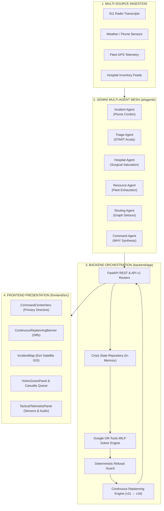

# 05_TECH_ARCHITECTURE.md
## LIFELINK: Technical Architecture & System Structure

---

### 1. Neuro-Symbolic Hybrid Architecture Paradigm

LIFELINK is architected around a strict separation of concerns:
$$\textbf{Cognition for Understanding} \;\longleftrightarrow\; \textbf{Mathematics for Guarantee} \;\longleftrightarrow\; \textbf{Humans for Authority}$$

```
┌─────────────────────────────────────────────────────────────────────────────────────────┐
│                                 LIFELINK SYSTEM BOUNDARY                                │
├────────────────────────────────┬───────────────────────────┬────────────────────────────┤
│ PERCEPTION LAYER               │ OPTIMIZATION CORE         │ DECISION AUTHORITY         │
│ (Google Gemini 2.5 Flash)      │ (Google OR-Tools MILP)    │ (Human Incident Commander) │
├────────────────────────────────┼───────────────────────────┼────────────────────────────┤
│ • 911 Audio Transcripts        │ • Hard Bed Capacities     │ • Tactical Veto Authority  │
│ • Paramedic Radio Wire         │ • Operating Room Limits   │ • 1-Click Action Approval  │
│ • Drone Aerial Imagery         │ • Universal O- Blood Caps │ • Mass Batch Execution     │
│ • Unstructured Hazard Reports  │ • Stretcher Vehicle Limits│ • Override Directives      │
│                                │ • Road Detour Penalties   │                            │
│  Output: Structured Parameters │  Output: Optimal Matrix   │  Output: Executed Order    │
│  (Acuity, Trauma, Plume Cordon)│  (Zero Constraint Breach) │  (Field Radio Dispatch)    │
└────────────────────────────────┴───────────────────────────┴────────────────────────────┘
```

---

### 2. Full Technology Stack

```
┌─────────────────────────────────────────────────────────────────────────────┐
│                              TECHNOLOGY STACK                               │
├───────────────────────┬─────────────────────────────────────────────────────┤
│ Backend API           │ Python 3.11+, FastAPI, Uvicorn ASGI, Pydantic v2    │
├───────────────────────┼─────────────────────────────────────────────────────┤
│ Optimization Engine   │ Google OR-Tools (MILP Solver: SCIP / CBC Solvers)   │
├───────────────────────┼─────────────────────────────────────────────────────┤
│ Cognitive AI Agents   │ Google Gemini 2.5 Flash / Pro Multimodal API        │
│                       │ + Zero-Dependency Deterministic Heuristic Fallback  │
├───────────────────────┼─────────────────────────────────────────────────────┤
│ Frontend Web App      │ React 18, Vite 5, Tailwind CSS, Lucide React        │
├───────────────────────┼─────────────────────────────────────────────────────┤
│ Geospatial GIS        │ Leaflet 1.9, Esri World Imagery (High-Res Satellite)│
│                       │ & OpenStreetMap Vector Tiles                        │
├───────────────────────┼─────────────────────────────────────────────────────┤
│ Containerization      │ Multi-stage Docker, Alpine Linux, Nginx, Compose    │
├───────────────────────┼─────────────────────────────────────────────────────┤
│ Testing & Audit       │ Python `unittest` (68 automated unit & system tests)│
└───────────────────────┴─────────────────────────────────────────────────────┘
```

---

### 3. Subsystem Architecture & Component Breakdown



---

### 4. Mathematical Formulation (Google OR-Tools MILP)

Casualty allocation is modeled as a Mixed-Integer Linear Program over graph $G = (V, E)$.

#### Sets & Indices
* $i \in I$: Set of triaged casualties
* $j \in J$: Set of active ambulances
* $k \in K$: Set of regional trauma centers / hospitals

#### Clinical & Spatial Parameters
* $w_i \in [1.0, 10.0]$: Triage urgency weight ($w_{\text{critical}} = 10.0, w_{\text{serious}} = 5.0, w_{\text{moderate}} = 2.0$)
* $t_{ij}$: Driving time from ambulance $j$ to casualty $i$
* $t_{ik}$: Driving time from casualty $i$ to hospital $k$
* $M_{ik} \in \{0, 1\}$: Binary capability mask (1 if hospital $k$ supports victim $i$'s required trauma/burn/surgical specialty, 0 otherwise)
* $C_k$: Available staffed ICU beds at hospital $k$
* $B_k$: Available O- blood units at hospital $k$
* $b_i$: Blood units required by casualty $i$
* $V_j$: Stretcher capacity of ambulance $j$ (typically 1)

#### Decision Variables
* $x_{ij} \in \{0, 1\}$: 1 if ambulance $j$ transports casualty $i$, 0 otherwise
* $y_{ik} \in \{0, 1\}$: 1 if casualty $i$ is admitted to hospital $k$, 0 otherwise

#### Mathematical Formulation
$$\min \sum_{i \in I} w_i \left( \sum_{j \in J} t_{ij} x_{ij} + \sum_{k \in K} t_{ik} y_{ik} \right) + \lambda \sum_{k \in K} \text{Overload}(k)$$

**Subject to:**
1. **Transport Coupling**:
   $$\sum_{k \in K} y_{ik} \le \sum_{j \in J} x_{ij} \le 1, \quad \forall i \in I$$
2. **Ambulance Stretcher Capacity**:
   $$\sum_{i \in I} x_{ij} \le V_j, \quad \forall j \in J$$
3. **Hospital Physical Bed Limit**:
   $$\sum_{i \in I} y_{ik} \le C_k, \quad \forall k \in K$$
4. **Specialty Capability Matching**:
   $$y_{ik} \le M_{ik}, \quad \forall i \in I, \; \forall k \in K$$
5. **Blood Reserve Bound**:
   $$\sum_{i \in I} b_i y_{ik} \le B_k, \quad \forall k \in K$$

---

### 5. Continuous Replanning State Machine

When a disruption event occurs, LIFELINK executes an 8-stage recalculation in $< 65\text{ ms}$:
```
EVENT (e.g. Hospital B ICU 2 -> 1)
  ↓
STATE UPDATE (Decrement St. Jude ICU to 1)
  ↓
INCIDENT REASONING (Flag surgical bottleneck)
  ↓
PRIORITY RECALCULATION (Evaluate acute queue)
  ↓
HOSPITAL MATCHING (Harborview ICU becomes target)
  ↓
RESOURCE OPTIMIZATION (OR-Tools solves Plan v12)
  ↓
ROUTING RECALCULATION (Route B contraflow assigned)
  ↓
COMMAND SYNTHESIS (Generate assignment diff: V129 -> Hosp C)
  ↓
DASHBOARD UPDATE (Hero + Replanning banner flash amber)
```

---

### 6. Offline Network Resilience Guarantee

LIFELINK is engineered to operate in communication-degraded disaster zones:
* **Zero External Network Dependencies**: The core OR-Tools optimizer, road network Dijkstra traversal, and START clinical scoring engine run 100% locally in-process.
* **Deterministic AI Fallback**: If Google Gemini API is unreachable, the system automatically falls back to deterministic rule-based NLP parsers without throwing unhandled exceptions.
