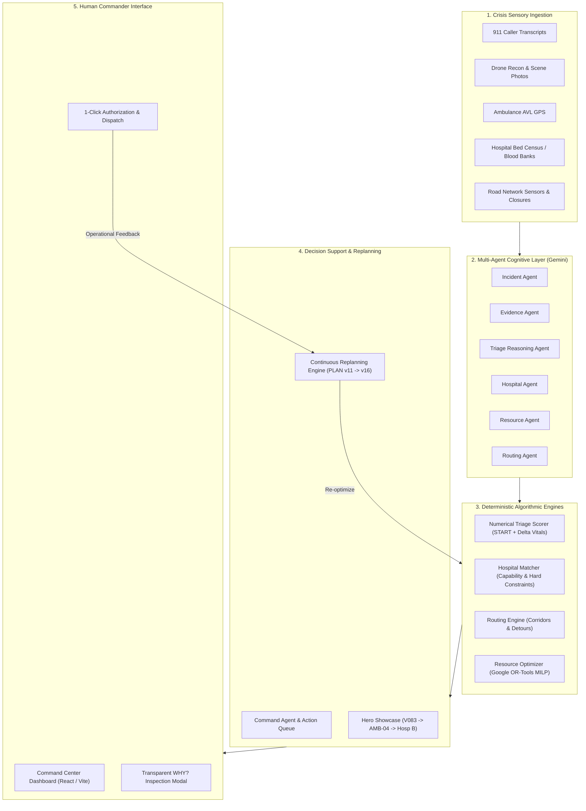
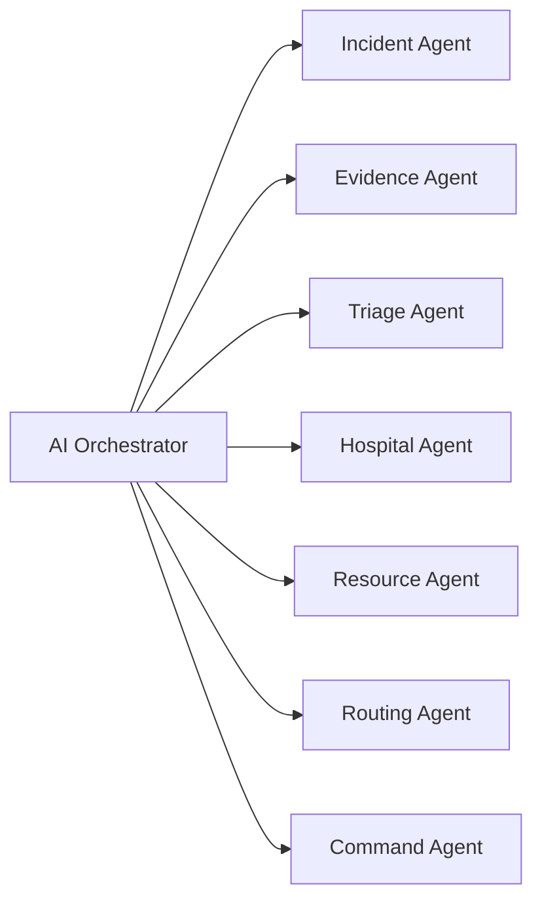

# LIFELINK Architecture & System Specification ⚡

> **A Neuro-Symbolic Crisis Response Platform Combining Multimodal Generative AI with Deterministic Mathematical Optimization.**

---

## 🏛️ 1. Core Architectural Philosophy

Emergency disaster response imposes zero-tolerance constraints:
1. **Combinatorial Disaster Complexity**: Allocating $N$ acute casualties across $M$ ambulances and $K$ receiving facilities with multi-resource requirements (ICU, blood, trauma teams, ventilators) is NP-hard.
2. **Zero Tolerance for LLM Hallucinations**: Generative AI models cannot be trusted to perform constrained discrete optimization. An LLM may hallucinate non-existent hospital beds or route vehicles through impassable blast debris.
3. **Provable Determinism**: Disaster commanders require verifiable, repeatable decisions grounded in hard clinical and physical realities.

LIFELINK resolves this dilemma through a strict **neuro-symbolic division of responsibilities**:

```
      COGNITION                     MATHEMATICS                     HUMAN AUTHORITY
┌─────────────────────┐       ┌──────────────────────┐       ┌────────────────────────┐
│  Generative AI      │       │  Deterministic       │       │  Incident Commander    │
│  (Google Gemini)    │  ───> │  Optimization        │  ───> │  (Human-in-the-Loop)   │
│                     │       │  (Google OR-Tools)   │       │                        │
│  • Understand text  │       │  • Constrained MILP  │       │  • Review rationale    │
│  • Interpret photos │       │  • Zero-diversion    │       │  • Authorize dispatch  │
│  • Extract vectors  │       │  • Hard boundaries   │       │  • Overwrite & command │
└─────────────────────┘       └──────────────────────┘       └────────────────────────┘
```

> **"Cognition for Understanding, Mathematics for Decision Guarantee, Humans for Authority."**

---

## 🏗️ 2. End-to-End System Architecture



---

## 🤖 3. The 7 Specialized Gemini AI Agents

LIFELINK does **not** employ a monolithic chatbot. It organizes intelligence into seven modular, domain-specific agents, each with strict input/output Pydantic schemas and deterministic fallback isolation:



| Agent Name | Primary Responsibility | Input Artifact | Structured JSON Output Schema |
|---|---|---|---|
| **Incident Agent** | Extracts structured incident type, estimated casualty counts, unconscious counts, and sector anchors from unstructured reports. | Raw text e.g., *"12 injured near Gate 3, 2 unconscious"* | `IncidentAgentOutput`: `incident_type`, `estimated_casualties`, `unconscious_count`, `location_sector`, `hazard_level`, `confidence` |
| **Evidence Agent** | Interprets scene photographs and thermal drone recon, identifying structural collapse, trapped casualties, and required PPE. | Aerial/drone visual descriptions | `EvidenceAgentOutput`: `scene_type`, `hazard_detected`, `entrapped_count`, `ppe_level_required`, `visual_evidence` |
| **Triage Reasoning Agent** | Analyzes patient presentation notes to identify anatomical injuries, required surgical capabilities, and START priority. | Paramedic clinical field notes | `TriageAgentOutput`: `suggested_priority`, `primary_anatomical_trauma`, `required_specialty`, `needs_icu`, `needs_blood` |
| **Hospital Agent** | Identifies critical care saturation, surgical bottlenecks, and diverts before physical transport begins. | Hospital inventories and capacity metrics | `HospitalAgentOutput`: `hospital_id`, `saturation_level`, `icu_available`, `bottlenecks`, `recommendation` |
| **Resource Agent** | Monitors ambulance fleet availability, blood inventories, and triggers mutual aid alarms (MABAS Tier 3). | Asset tracking registries | `ResourceAgentOutput`: `fleet_exhaustion_detected`, `mutual_aid_recommended`, `resource_bottlenecks` |
| **Routing Agent** | Synthesizes physical road closures, computes detours, and generates human-readable convoy instructions. | Road obstacle status & hazard vectors | `RoutingAgentOutput`: `active_route`, `is_rerouted`, `avoided_hazards`, `corridor_guidance` |
| **Command Agent** | Synthesizes all intelligence layers into actionable commander briefings and prioritized directives. | OR-Tools optimization solution + agent assessments | `CommanderBriefing`: `incident_headline`, `overall_threat_level`, `critical_tradeoffs_explained`, `actionable_directives` |

### Deterministic Fallback Protection
If an LLM call fails, times out, or returns malformed non-JSON data, each agent catches `(json.JSONDecodeError, ValidationError, TypeError)` and engages **deterministic heuristic fallbacks** with `fallback_used=True` and `confidence=0.5`. **The system never crashes or halts emergency operations due to an external API failure.**

---

## 📐 4. The Mathematical Optimization Layer (Google OR-Tools MILP)

Dispatch and resource allocation are formulated as a **Constrained Mixed-Integer Linear Program (MILP)** solved via Google OR-Tools CBC/SCIP.

### Decision Variables
$$x_{ijk} \in \{0, 1\}$$
Binary variable: $1$ if casualty $i \in \mathcal{V}$ is assigned to transport unit $j \in \mathcal{A}$ for delivery to hospital $k \in \mathcal{H}$; $0$ otherwise.

### Objective Function
$$\max \sum_{i \in \mathcal{V}} \sum_{j \in \mathcal{A}} \sum_{k \in \mathcal{H}} \left( W_i \cdot \text{Benefit}(i, k) - \lambda \cdot t_{ik} \right) x_{ijk}$$

Where:
- $W_i$: Severity priority weight derived from START triage ($W_{\text{P1}} = 100$, $W_{\text{P2}} = 60$, $W_{\text{P3}} = 20$).
- $\text{Benefit}(i, k)$: Clinical capability alignment score (ICU availability, blood units, trauma operating suites).
- $\lambda$: Transit penalty multiplier ($1.5$).
- $t_{ik}$: Transit time in minutes factoring in active road obstacles.

### Hard Constraints

1. **Single Assignment Constraint**: Each casualty is assigned to at most one vehicle and hospital:
   $$\sum_{j \in \mathcal{A}} \sum_{k \in \mathcal{H}} x_{ijk} \le 1 \quad \forall i \in \mathcal{V}$$

2. **Hospital ICU Bed Capacity**: The total critical casualties assigned to hospital $k$ cannot exceed open ICU beds:
   $$\sum_{i \in \mathcal{V}_{\text{ICU}}} \sum_{j \in \mathcal{A}} x_{ijk} \le \text{ICU}_k \quad \forall k \in \mathcal{H}$$

3. **Ambulance Capacity & Utilization**: Each transport unit can transport at most its licensed stretcher capacity:
   $$\sum_{i \in \mathcal{V}} \sum_{k \in \mathcal{H}} x_{ijk} \le \text{Capacity}_j \quad \forall j \in \mathcal{A}$$

4. **Medical Specialty Capability Match**:
   $$x_{ijk} \le \text{CapMatch}(i, k) \quad \forall i, j, k$$
   Where $\text{CapMatch}(i, k) = 0$ if hospital $k$ lacks the required trauma, neurosurgical, or burn specialty.

5. **Universal Donor Blood Availability**: Bleeding casualties requiring emergency transfusion cannot be routed to facilities with depleted O-Negative reserves:
   $$x_{ijk} \le \mathbb{I}\left(\text{Blood}_{k, \text{O-}} \ge 3\right) \quad \forall i \in \mathcal{V}_{\text{bleeding}}$$

---

## 🔄 5. The Continuous Replanning Engine (Phase 10)

Traditional emergency dispatch is static: once a vehicle is sent, changes in the field cause chaotic hospital turnaways. LIFELINK implements an autonomous **8-step continuous closed-loop replanning cycle**:

$$\text{EVENT} \longrightarrow \text{UNDERSTAND} \longrightarrow \text{PRIORITIZE} \longrightarrow \text{OPTIMIZE} \longrightarrow \text{ASSIGN} \longrightarrow \text{EXPLAIN} \longrightarrow \text{COMMANDER} \longrightarrow \text{REPLAN}$$

```
                ┌────────────────────────────────────────────────────────┐
                │             CONTINUOUS REPLANNING LOOP                 │
                └────────────────────────────────────────────────────────┘
                                           │
  1. EVENT             Disruption Trigger (ICU Drop, Road Block, Casualty Surge)
                                           │
  2. UNDERSTAND        Multi-Agent Re-evaluation of Network Capabilities
                                           │
  3. PRIORITIZE        Recalculate Numerical Triage Scores for All Casualties
                                           │
  4. OPTIMIZE          Execute Google OR-Tools MILP Solver (< 50 ms)
                                           │
  5. ASSIGN            Calculate Delta between Plan v(N) and Plan v(N+1)
                                           │
  6. EXPLAIN           Generate Human-Readable Assignment Diffs (V129: Hosp B -> C)
                                           │
  7. COMMANDER         Present "PLAN UPDATED" Banner on Tactical Dashboard
                                           │
  8. REPLAN            Inject Audit Record into Incident Timeline -> Await Next Event
```

### Plan Versioning & Diff Tracking
Every replan increments the plan version (e.g., `PLAN v11` $\longrightarrow$ `PLAN v12`), calculates concrete assignment diffs (`victim_id`, `previous_destination`, `new_destination`, `change_reason`), and logs an immutable audit event to the incident timeline.

---

## 🚫 6. Deterministic Refusal & Clinical Safety (Phase 13)

LIFELINK strictly enforces **Deterministic Refusal**:
> **When hard clinical or physical constraints make an allocation impossible, the system refuses to fabricate a phantom assignment.**

Instead, the system explicitly outputs:
```
⚠️ NO FEASIBLE ASSIGNMENT
CRITICAL CONSTRAINT BREACH • SYSTEM REFUSAL ENFORCED
Reason: All regional hospitals have 0 open ICU beds. Crisis standards required.
```

The system triggers actionable mutual aid directives:
- `DECLARE CRISIS STANDARDS OF CARE & REVERSE TRIAGE` (+8 to +12 regional beds via rapid step-down)
- `REQUEST REGION II TIER 3 EMS MUTUAL AID` (+15 mutual aid transport units)
- `DEPLOY STATE BLOOD BANK EMERGENCY CONVOY` (+40 units universal donor O- blood)

