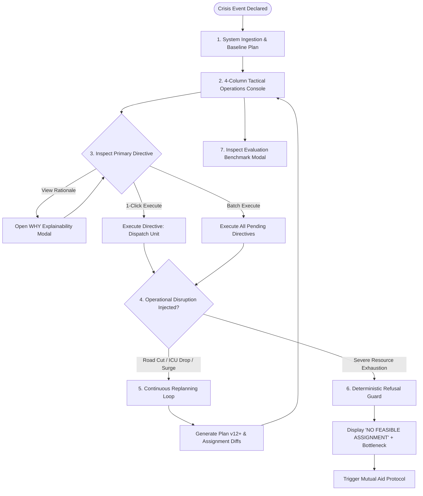
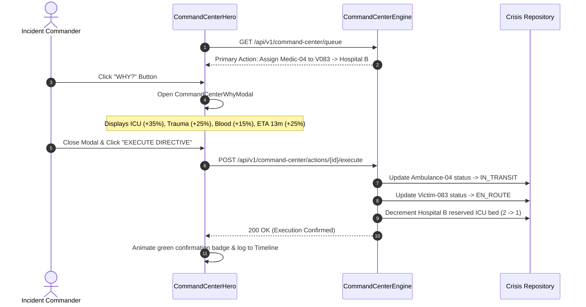
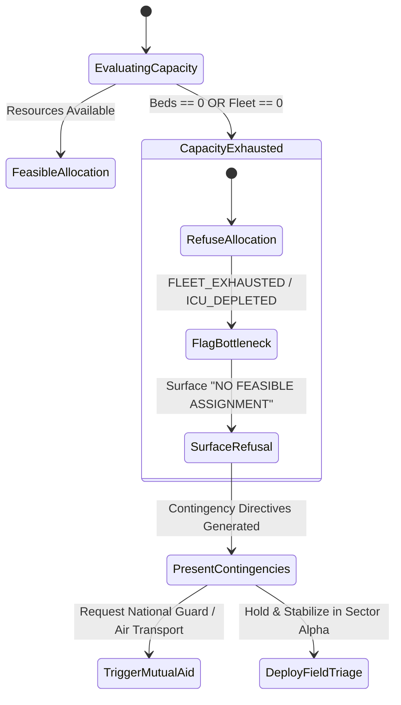

# 02_USER_FLOW.md
## LIFELINK: User Flow & Interaction State Machine

---

### 1. Global User Journey Overview

LIFELINK is engineered around an action-dominant, low-latency loop:
$$\boxed{\text{DETECT CRISIS}} \longrightarrow \boxed{\text{ASSESS SITUATION}} \longrightarrow \boxed{\text{REVIEW DIRECTIVE}} \longrightarrow \boxed{\text{EXECUTE / OVERRIDE}} \longrightarrow \boxed{\text{ADAPT ON DISRUPTION}}$$

---

### 2. Detailed Interaction Flows

#### Flow 1: Crisis Declaration & Baseline Initialization
1. **User Action**: The Incident Commander logs into the LIFELINK command console or loads an active crisis file (`INC-2026-OMEGA-04`: Freight Derailment & Chemical Tanker Rupture).
2. **System Response**:
   * Telemetry streams populate Sector Alpha (Structural Collapse), Sector Bravo (Chemical Plume), and Sector Charlie (Concourse).
   * Total casualty tally is ingested: 214 casualties (31 Critical P1, 67 Serious P2, 82 Moderate P3, 34 In Rubble P4).
   * Google OR-Tools MILP solves the initial resource allocation in $< 60\text{ ms}$.
   * Plan `v11` is established as the active operational baseline.

---

#### Flow 2: Live Tactical Overview (4-Column Console)
The commander monitors the live operational theater through 4 synchronized panes:
* **Left Rail (Incident Brief & HazMat Telemetry)**:
  * Reads real-time anhydrous ammonia plume vector ($14\text{ kts WNW}$, 800m downwind cordon).
  * Listens/reads live dispatch audio wire with timestamped radio intercepts.
* **Center-Left (Tactical GIS Map)**:
  * Inspects casualty clusters, hospital locations, and ambulance GPS positions on high-res satellite imagery.
  * Observes the severed red dashed line on Highway 101 Overpass 4 (+14 min penalty).
  * Toggles between `[🛰️ Satellite]` photorealistic photography and `[🗺️ Street]` vector grid.
* **Center-Right (Casualty Acuity Queue)**:
  * Searches by patient ID or filters by START tag (Immediate, Delayed, Minor, Deceased).
  * Reviews matched receiving facilities, transport ETAs, and anatomical trauma tags.
* **Right Rail (Hospital & Fleet Status)**:
  * Monitors critical ICU bed inventory (Metro Trauma: 0, St. Jude: 2, Harborview: 1).
  * Checks O- blood bank reserves and active operating room availability.
  * Tracks ambulance transport fleet readiness (Medic 1 to 5).

---

#### Flow 3: Incident Commander Directive Review & Execution

---

#### Flow 4: Dynamic Disruption & Continuous Replanning Loop
When conditions change in the field, LIFELINK does not require manual recalculation:
1. **Disruption Triggered**: Hospital B ICU drops from 2 beds to 1 bed due to internal surgical emergency.
2. **Orchestrator Trigger**: Continuous Replanning Engine intercepts state change.
3. **Recalculation**: OR-Tools re-solves the MILP matrix across remaining casualties in $48\text{ ms}$.
4. **Plan Versioning**: System bumps active plan from `v11` to `v12`.
5. **Diff Generation**:
   * Victim `V129` rerouted: `Hospital B (St. Jude)` ──► `Hospital C (Harborview Memorial)`.
   * Causal explanation: *"Hospital B ICU reduced to 1 bed, reserved for severe crush trauma V083. V129 rerouted to Hospital C which maintains open neuro-ICU capacity."*
6. **UI Notification**: The **Continuous Replanning Banner** flashes amber, presents the exact assignment diff, and updates the timeline.

---

#### Flow 5: Resource Scarcity & Deterministic Refusal Protocol
When casualty volume exceeds regional physical capacity (e.g. 36 critical victims with only 5 ambulances and 3 ICU beds):

1. **Safety Trigger**: The optimizer detects zero open ICU beds across the metropolitan region.
2. **Refusal Enforcement**: Rather than hallucinating a phantom bed, the solver returns `INFEASIBLE`.
3. **Commander UI Display**:
   * Banner status: `NO FEASIBLE ASSIGNMENT` (High-contrast red indicator).
   * Bottleneck breakdown: *"REGIONAL ICU CAPACITY EXHAUSTED (0 beds open / 14 critical casualties awaiting admission)."*
4. **Action Recommendations**: Automatically surfaces contingency actions:
   * Directive 1: Trigger Regional Disaster Mutual Aid Tier 3 (request transport from outer county).
   * Directive 2: Authorize Air Medical Evacuation to Stanford University Trauma Center (18 min flight).
   * Directive 3: Deploy field stabilization holding protocol in Sector Alpha triage tent.

---

#### Flow 6: Simulation Evaluation & Benchmark Inspection
1. **User Action**: The commander or hackathon judge clicks **"EVALUATION METRICS"** in the top navigation bar.
2. **System Response**:
   * Opens the **Simulation Evaluation Modal**.
   * Renders side-by-side comparison between **Traditional Manual Crisis Dispatch** vs. **LIFELINK Autonomous Optimization**.
   * Details:
     * Time to Feasible Plan: $14.5\text{ min}$ vs. **$50.1\text{ ms}$** ($17,365\times$ faster).
     * Critical Coverage: $51.6\%$ vs. **$100.0\%$**.
     * ICU Diversions / Overload: 4 overflow diversions vs. **0 conflicts**.
     * Mean Event Replanning Latency: $8.2\text{ min}$ vs. **$63.8\text{ ms}$**.
   * Prominently displays the mandatory synthetic simulation disclaimer.

