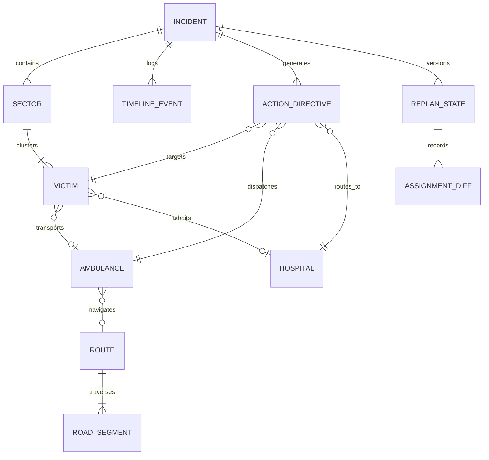

# 06_DATA_MODEL.md
## LIFELINK: Data Model, Entity Schemas & Relational Graph

---

### 1. Entity-Relationship Diagram (ERD)



---

### 2. Core Domain Entities & Pydantic V2 Schemas

#### 2.1 `Incident` (Crisis Root)
```python
class Incident(BaseModel):
    id: str = Field(..., description="Unique crisis identifier (e.g. INC-2026-OMEGA-04)")
    codename: str = Field(..., description="Tactical operation name")
    type: str = Field(..., description="Crisis taxonomy (e.g. Train Derailment / Toxic Inhalation)")
    severity: str = Field(..., description="MCI triage severity level (Code Black / Level 3)")
    location: GeoLocation
    declared_at: str = Field(..., description="Time declared (HH:MM:SS)")
    elapsed_minutes: int
    status: str = Field(default="active", pattern="^(active|contained|cleared)$")
    summary: str
    sectors: List[Sector] = []
    statistics: IncidentStatistics
```

#### 2.2 `Victim` (Casualty Record)
```python
class TriagePriority(str, Enum):
    P1_CRITICAL = "P1"       # Immediate (Red)
    P2_SERIOUS = "P2"        # Delayed (Yellow)
    P3_MODERATE = "P3"       # Minor / Walking Wounded (Green)
    P4_UNKNOWN = "P4"        # Unassessed in Rubble (Purple/Black)
    P0_DECEASED = "P0"       # Non-salvageable (Black)

class Victim(BaseModel):
    id: str = Field(..., description="Unique casualty identifier (e.g. V083)")
    sector_id: str = Field(..., description="Foreign key to Sector")
    priority: TriagePriority
    condition: str = Field(..., description="Primary clinical presentation")
    anatomical_trauma: List[str] = Field(default_factory=list)
    icu_required: bool = False
    blood_units_needed: int = 0
    surgical_specialty_required: Optional[str] = None
    assigned_ambulance_id: Optional[str] = None
    assigned_hospital_id: Optional[str] = None
    transport_eta_minutes: Optional[float] = None
    status: str = Field(default="TRIAGED", pattern="^(TRIAGED|ASSIGNED|IN_TRANSIT|DELIVERED)$")
```

#### 2.3 `Hospital` (Definitive Care Facility)
```python
class BloodInventory(BaseModel):
    O_negative: int = Field(..., ge=0, description="Universal donor emergency reserves")
    O_positive: int = Field(..., ge=0)
    A_positive: int = Field(..., ge=0)

class Hospital(BaseModel):
    id: str = Field(..., description="Facility identifier (e.g. H-A, H-B, H-C)")
    name: str = Field(..., description="Full facility name (e.g. St. Jude Regional Hospital)")
    type: str = Field(..., description="Trauma certification (Level 1 Trauma Center, etc.)")
    location: GeoLocation
    icu: int = Field(..., ge=0, description="Current unreserved staffed ICU beds")
    icu_total: int = Field(..., ge=1, description="Total licensed ICU beds")
    operating_rooms_open: int = Field(..., ge=0)
    burn_beds_available: int = Field(default=0, ge=0)
    blood: BloodInventory
    supported_specialties: List[str] = Field(default_factory=list)
    eta_minutes: float
    distance_km: float
    status: str = Field(..., description="Operational status: OPERATIONAL | SURGE_CRITICAL | SATURATED")
```

#### 2.4 `Ambulance` (Transport Asset)
```python
class AmbulanceType(str, Enum):
    ALS = "ALS"               # Advanced Life Support (Paramedic unit)
    BLS = "BLS"               # Basic Life Support (EMT unit)
    AIR = "AIR_AMBULANCE"     # Critical care medical helicopter

class AmbulanceStatus(str, Enum):
    AVAILABLE = "AVAILABLE"
    DISPATCHED = "DISPATCHED"
    EN_ROUTE = "EN_ROUTE"
    IN_TRANSIT = "IN_TRANSIT"
    AT_HOSPITAL = "AT_HOSPITAL"

class Ambulance(BaseModel):
    id: str = Field(..., description="Vehicle identifier (e.g. AMB-04)")
    callsign: str = Field(..., description="Tactical voice callsign (e.g. Medic 4)")
    type: AmbulanceType
    status: AmbulanceStatus
    location: GeoLocation
    current_victim_id: Optional[str] = None
    assigned_destination: Optional[str] = None
    eta_minutes: float = 0.0
    crew_lead: str = Field(..., description="Paramedic in charge")
```

#### 2.5 `ActionDirective` (Command Recommendation)
```python
class WhyScorecard(BaseModel):
    icu_score: float = Field(..., ge=0.0, le=1.0)
    trauma_score: float = Field(..., ge=0.0, le=1.0)
    blood_score: float = Field(..., ge=0.0, le=1.0)
    eta_score: float = Field(..., ge=0.0, le=1.0)
    composite_utility: float = Field(..., ge=0.0, le=1.0)

class ActionDirective(BaseModel):
    id: str = Field(..., description="Unique action directive identifier (e.g. ACT-001)")
    priority_rank: int = Field(..., ge=1, description="Rank in queue (1 = Dominant Hero Action)")
    title: str = Field(..., description="Headline order (e.g. ASSIGN AMBULANCE-04 to VICTIM-083)")
    victim_id: str
    ambulance_id: str
    hospital_id: str
    route_id: str
    eta_minutes: float
    reason: str = Field(..., description="Plain-language clinical and tactical justification")
    why_factors: WhyScorecard
    execution_status: str = Field(default="PENDING", pattern="^(PENDING|EXECUTED|REJECTED)$")
```

#### 2.6 `ReplanState` (Continuous Replanning State Machine)
```python
class AssignmentDiff(BaseModel):
    victim_id: str
    previous_hospital_id: str
    new_hospital_id: str
    reason: str

class ReplanState(BaseModel):
    plan_version: str = Field(..., description="Version label: PLAN v11, PLAN v12, etc.")
    timestamp: str = Field(..., description="ISO 8601 or local incident timestamp")
    trigger_event: str = Field(..., description="Cause of replan (e.g. Hospital B ICU 2 -> 1)")
    previous_plan_version: str
    assignment_diffs: List[AssignmentDiff] = []
    affected_victims: List[str] = []
    affected_resources: List[str] = []
```

---

### 3. Data Integrity & Invariant Rules

1. **Stretcher Exclusivity Constraint**:
   $$\sum_{i \in I} \mathbb{I}(\text{victim.assigned\_ambulance\_id} = j) \le 1, \quad \forall j \in J$$
   *No two victims can simultaneously occupy the same ambulance.*

2. **Physical ICU Bed Non-Negativity**:
   $$\text{hospital.icu} \ge 0, \quad \forall k \in K$$
   *Hospital available ICU bed counts can never drop below zero.*

3. **Triage Monotonicity Invariant**:
   A casualty tagged $P1$ (Critical) must always be allocated prior to $P2$ (Serious) and $P3$ (Moderate) unless physical specialty matching prevents it ($M_{ik} = 0$).

4. **Audit Trail Immutability**:
   `TimelineEvent` records are append-only. Once an event is logged, it cannot be modified or deleted.

